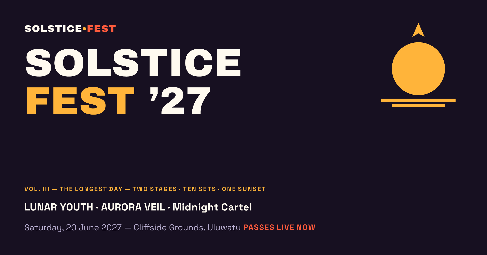
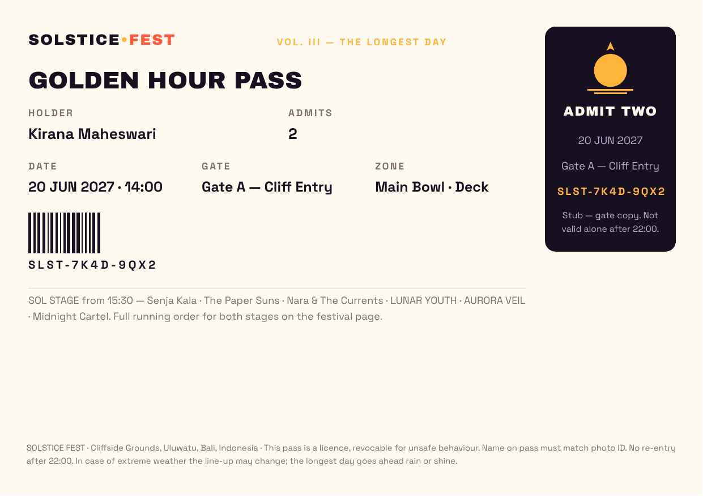
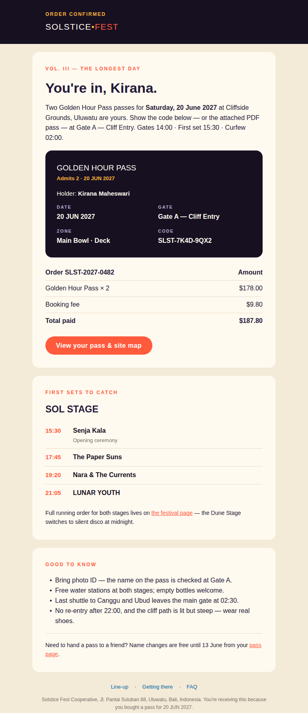
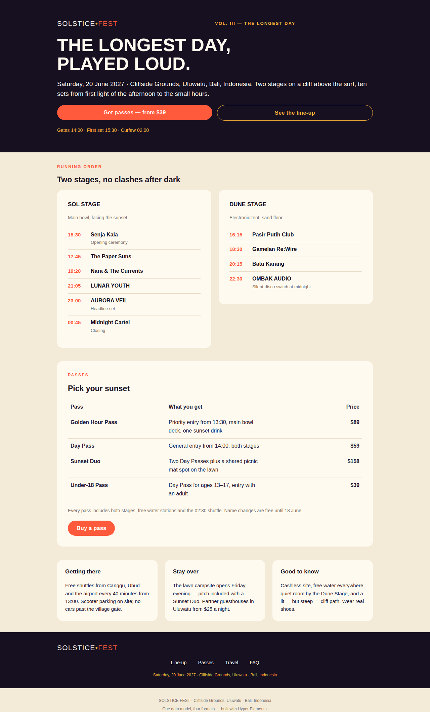

# Solstice Fest Kit — one festival, four formats, one source of truth

A complete ticketing kit for a fictional one-day music festival in Uluwatu, Bali, built with **Hyper Elements**. Instead of four disconnected templates, the kit is **one data model + one theme + a handful of shared components**, rendered to four different outputs:

| # | Output | Root | Renderer | File |
|---|--------|------|----------|------|
| 1 | Order confirmation email (+ plain text) | `Email` | `render()` | `out/confirmation-email.html` |
| 2 | Printable pass, A5 landscape PDF | `Document` | `renderPdf()` | `out/ticket.pdf` |
| 3 | Public event page | `Page` | `render()` | `out/event-page.html` |
| 4 | Social / Open Graph card, 1200×630 PNG | `Canvas` | `renderImage()` | `out/share-card.png` |

Change the line-up, the date or a price in `src/data.ts`, run one build, and the inbox, the printed ticket, the website and the share card all agree with each other. That is the whole idea.





The confirmation email and the event page (the email HTML uses email-safe font fallbacks, exactly as real clients will draw it):





A Gmail-drawn preview of the same email is in `previews/email-gmail.png`, and `out/clients/` holds the per-client preview files for Outlook, Gmail and Apple Mail.

## How Hyper Elements is used

- **One theme for every root** — `src/theme.ts` defines the sunset palette (plum ink, warm cream, amber, coral), the two display faces (Archivo Black for headings, Space Grotesk for body) and shared named styles (`card`, `darkCard`, `eyebrow`, `metaLabel`) with `defineTheme`. All four roots take `theme={solstice}`.
- **Shared components, not copies** — `src/components.tsx` holds the blocks every surface reuses: `Wordmark`, `TicketFacts` (date/gate/zone/code), `SetList` (running order), `MetaPair`, plus two drawn-not-downloaded graphics: a `SunDisc` and a `Barcode` whose bar pattern is generated from the ticket code, so every pass prints a unique barcode. There are **no image assets anywhere in this kit** — every visual is an element or an `Svg` shape.
- **Each root plays to its strength** — the email uses `Section` bands, a dark inverted ticket card (token override via a named style), a `Table` for the order, and degrades gracefully; the ticket is an A5 landscape `Document` with a tear-off stub column and a `PageFooter` with the fine print; the page uses `Grid` for the two stages and the info columns; the card is a fixed-size `Canvas` composed like a poster.
- **The agent feedback loop is the build** — `src/build.tsx` runs `validate()` on all four templates (and fails the build on any error), prints `outline()` of the email, then renders everything into `out/`. It also validates the email with the `@hyper-elements/email-clients` plugin — the checks for what classic Outlook, Gmail and Apple Mail remove or change — and writes one preview file per client to `out/clients/` (`outlook.html`, `gmail.html`, `gmail.mac.html`, `apple-mail.html`, `apple-mail.iphone.html`). The only findings are graceful degradations (square corners and un-drawn letter-spacing in classic Outlook).
- **Fonts are explicit** — the PDF and image renderers receive the actual font files (WOFF, from the `@fontsource` packages) in their `fonts` option, because Hyper Elements loads none itself. Archivo Black ships a single weight, so the same file is registered at 400 and 700 to keep renders warning-free.

## Run it

```bash
npm install
npm run build
```

Node 18+ is enough; there is no dev server and no API key — everything renders locally. Outputs land in `out/`:

- `confirmation-email.html` / `confirmation-email.txt` — ready for any email provider
- `clients/` — the email as Outlook, Gmail and Apple Mail draw it
- `ticket.pdf` (+ `ticket-print.html`) — the printable pass
- `event-page.html` — a complete responsive page
- `share-card.png` / `share-card.svg` — the social card at 2× and as vector

## Make it yours

Everything festival-specific lives in `src/data.ts`: event, stages and set times, pass tiers, attendee, order and ticket. Swap in a conference, a wedding or a football final, restyle `src/theme.ts`, and the same four surfaces come out on-brand. The templates are `src/templates/ConfirmationEmail.tsx`, `TicketDocument.tsx`, `EventPage.tsx` and `ShareCard.tsx`.

## License

MIT
